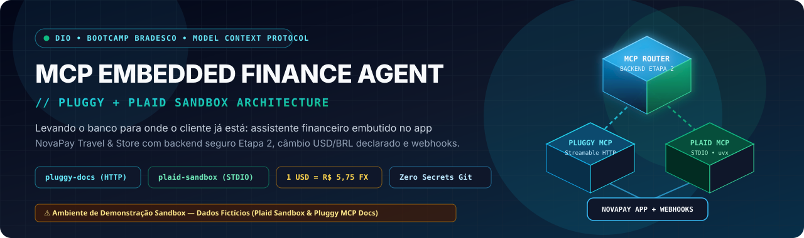
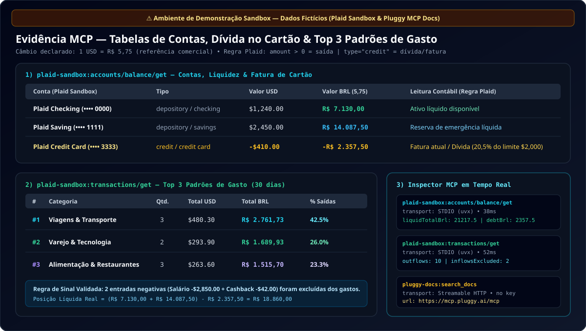
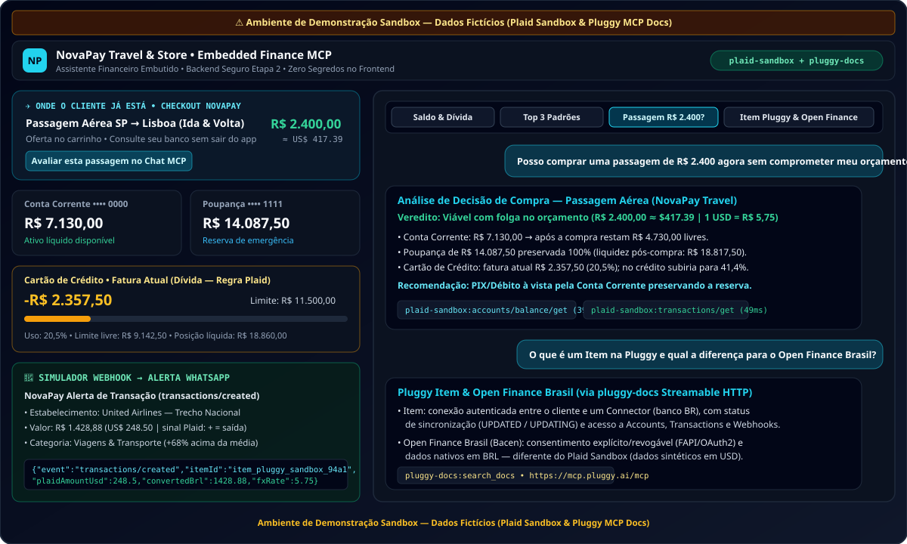

<p align="center">
  
</p>

<h1 align="center">NovaPay Travel &amp; Store — Agente Financeiro Embedded com MCP</h1>

<p align="center">
  <strong>Desafio de Projeto DIO (Bootcamp Bradesco — Agentes de IA do Zero à Prática)</strong><br/>
  <em>"Levando o Banco para Onde o Cliente Já Está: Um Agente Financeiro com Model Context Protocol (MCP)"</em>
</p>

<p align="center">
  <a href="https://lcszero44-cell.github.io/mcp-embedded-finance-agent/">
    
  </a>
  
  
  
</p>

> ⚠️ **Aviso Permanente de Ambiente:** **Ambiente de Demonstração Sandbox — Dados Fictícios (Plaid Sandbox & Pluggy MCP Docs)**. Nenhuma credencial, token ou dado bancário real está versionado neste repositório ou exposto no frontend.

---

## 🔗 Acesso Rápido

- **Aplicação Web Publicada (Live Demo):** [https://lcszero44-cell.github.io/mcp-embedded-finance-agent/](https://lcszero44-cell.github.io/mcp-embedded-finance-agent/)
- **Configuração MCP Pronta (Codex / Claude / Cursor / Antigravity):** [`mcp/mcp_servers.json`](./mcp/mcp_servers.json)
- **Skill Reutilizável de Agente MCP:** [`.agent/skills/mcp-financial-connector/SKILL.md`](./.agent/skills/mcp-financial-connector/SKILL.md)
- **Especificação OpenSpec Completa:** [`docs/OPENSPEC_LOVABLE.md`](./docs/OPENSPEC_LOVABLE.md)

---

## 1. Onde o Cliente Já Está, o que o Assistente Responde Ali e de Onde Vem Cada Dado

### Cenário Real de Embedded Finance — **NovaPay Travel & Store**
Em vez de obrigar o cliente a sair do aplicativo de compras, abrir o app do banco, conferir saldo, calcular limite de cartão e voltar ao carrinho, o assistente financeiro vive **embutido no checkout da NovaPay Travel & Store** (plataforma de viagens e varejo de tecnologia).

No momento exato da decisão (ex.: emitir uma **passagem aérea SP → Lisboa de R$ 2.400,00** ou comprar um **notebook de R$ 4.500,00**), o cliente consulta sua posição financeira consolidada em português, com câmbio declarado (`1 USD = R$ 5,75`) e transparência total das ferramentas MCP acionadas.

### Mapa Completo: Pergunta → Ferramenta MCP → Endpoint / Fonte → Resposta

| Pergunta do Cliente no App | Servidor MCP | Ferramenta / Transporte | Endpoint / Fonte de Dados | O que o Assistente Entrega |
|---|---|---|---|---|
| *"Qual é o meu saldo atual e quanto tenho de dívida no cartão?"* | `plaid-sandbox` | `accounts/balance/get` (`STDIO` via `uvx`) | Plaid Sandbox API (`/accounts/balance/get` + fallback determinístico Etapa 2) | Tabela com Conta Corrente, Poupança, Cartão de Crédito (**explicando que `type="credit"` é dívida/fatura**), Posição Líquida Real e conversão USD → BRL declarada. |
| *"Mostre uma tabela com meus 3 principais padrões de gasto e gastos por categoria."* | `plaid-sandbox` | `transactions/get` (`STDIO` via `uvx`) | Plaid Sandbox API (`/transactions/get` com janela de `30d / 60d / 90d`) | Ranking dos **Top 3 padrões de gasto** + quebra completa por categoria, filtrando apenas saídas (`amount > 0`) e excluindo receitas/estornos (`amount < 0`). |
| *"Posso comprar uma passagem de R$ 2.400 agora sem comprometer meu orçamento?"* | `plaid-sandbox` | `accounts/balance/get` + `transactions/get` | Orquestrador Backend `/api/chat` + Motor Financeiro | Simulação antes/depois na Conta Corrente, preservação da Poupança, projeção de uso do limite do cartão e recomendação de pagamento (PIX/Débito vs Crédito). |
| *"O que é um Item na Pluggy e qual a diferença para o Open Finance Brasil?"* | `pluggy-docs` | `search_docs` (`Streamable HTTP`, sem chave) | Servidor oficial **`https://mcp.pluggy.ai/mcp`** (JSON-RPC 2.0 ao vivo + base oficial Pluggy) | Definição técnica de `Item` e `Connector`, quadro comparativo Plaid Sandbox vs Open Finance Brasil (Bacen, consentimento explícito FAPI/OAuth2, BRL, Webhooks) e fontes oficiais. |
| *"Simular alerta de webhook de nova transação no WhatsApp."* | `webhook-simulator` | `webhook:transactions/created` | Backend `/api/webhook/simulate` (padrão Pluggy Webhooks) | Payload JSON técnico do webhook + preview realista de notificação **WhatsApp & Push** (gasto acima da média, fechamento de fatura ou teto de viagens). |

### Regras Contábeis & Convenção de Sinal da Plaid (Validadas por Testes)
- **Transações (`transactions/get`):** `amount > 0` = **saída/gasto**; `amount < 0` = **entrada/receita/estorno** (nunca contabilizado como gasto).
- **Cartão de Crédito (`type: "credit"`):** `balances.current` = **fatura atual / passivo**, sempre **subtraído** da posição líquida (`(Conta Corrente + Poupança) - Fatura`).
- **Conversão Monetária Declarada:** Toda exibição em Real informa explicitamente **`1 USD = R$ 5,75 — câmbio comercial de referência declarado`**.

---

## 2. Como Configurar os Servidores MCP da Pluggy (Streamable HTTP) e da Plaid (STDIO via `uvx`)

O arquivo [`mcp/mcp_servers.json`](./mcp/mcp_servers.json) já contém a configuração padrão compatível com **Codex, Claude Desktop/Code, Cursor e Antigravity**, usando apenas variáveis de ambiente (zero segredos hardcoded):

```json
{
  "mcpServers": {
    "pluggy-docs": {
      "transport": "streamable-http",
      "type": "http",
      "url": "https://mcp.pluggy.ai/mcp"
    },
    "plaid-sandbox": {
      "transport": "stdio",
      "type": "stdio",
      "command": "uvx",
      "args": ["mcp-server-plaid"],
      "env": {
        "PLAID_CLIENT_ID": "${PLAID_CLIENT_ID}",
        "PLAID_SECRET": "${PLAID_SECRET}",
        "PLAID_ENV": "sandbox"
      }
    }
  }
}
```

### Passo a Passo — Windows (PowerShell)

```powershell
# 1. Instalar uv / uvx (necessário para o servidor STDIO da Plaid)
powershell -ExecutionPolicy ByPass -c "irm https://astral.sh/uv/install.ps1 | iex"
uvx --version

# 2. Copiar template de variáveis de ambiente (NUNCA commitar .env)
Copy-Item .env.example .env

# 3. Configurar credenciais Plaid Sandbox localmente (apenas na sessão ou no .env)
$env:PLAID_CLIENT_ID = "your_sandbox_client_id"
$env:PLAID_SECRET    = "your_sandbox_secret"
$env:PLAID_ENV       = "sandbox"

# 4. Validar conectividade com o servidor MCP oficial da Pluggy (sem API key)
curl.exe -iL https://mcp.pluggy.ai/mcp
```

### Passo a Passo — macOS / Linux (Bash/Zsh)

```bash
# 1. Instalar uv / uvx
curl -LsSf https://astral.sh/uv/install.sh | sh
uvx --version

# 2. Copiar template de ambiente local
cp .env.example .env

# 3. Exportar credenciais Plaid Sandbox
export PLAID_CLIENT_ID="your_sandbox_client_id"
export PLAID_SECRET="your_sandbox_secret"
export PLAID_ENV="sandbox"

# 4. Validar Pluggy MCP (Streamable HTTP)
curl -iL https://mcp.pluggy.ai/mcp
```

### Skill Reutilizável de Agente MCP
Toda a governança de setup, roteamento entre `pluggy-docs` e `plaid-sandbox`, regra de sinal da Plaid, conversão USD/BRL e checklist de segurança foi empacotada na skill reutilizável:
- 📄 [`.agent/skills/mcp-financial-connector/SKILL.md`](./.agent/skills/mcp-financial-connector/SKILL.md)

---

## 3. Especificação OpenSpec Enviada ao Lovable / Builder e Ajustes Realizados

A especificação completa no formato **OpenSpec** e o diagrama do fluxo end-to-end estão documentados em [`docs/OPENSPEC_LOVABLE.md`](./docs/OPENSPEC_LOVABLE.md).

### Principais Ajustes de Engenharia Pós-OpenSpec
1. **Arquitetura Híbrida Etapa 2 (Backend Seguro + Resiliência Static SPA):** Implementamos API backend em TypeScript (`server/index.ts`, `server/mcpClient.ts` e funções Serverless em `api/`), mantendo fallback transparente no motor determinístico (`src/core/`) para que a demonstração publicada no GitHub Pages funcione 100% sem falhas para qualquer avaliador.
2. **Conexão Real ao Pluggy MCP com Suporte a Redirect 307:** O endpoint `https://mcp.pluggy.ai/mcp` redireciona (`307`) para `/en/mcp`; o cliente server-side segue o redirect e negocia o handshake JSON-RPC 2.0 Streamable HTTP ao vivo (`mode: "live-mcp"`).
3. **Extração Dinâmica de Valores de Compra:** Além da passagem de `R$ 2.400`, o chat interpreta qualquer valor informado em reais (ex.: *"Posso comprar um notebook de R$ 4.500?"*) e recalcula liquidez e uso do limite instantaneamente.
4. **Sanitizador Defensivo (`sanitizeResponsePayload`):** Camada de proteção validada por testes automatizados que remove/mascara preventivamente qualquer campo ou padrão parecido com `PLAID_SECRET`, `PLAID_CLIENT_ID` ou `access_token`.
5. **Normalização Monetária PT-BR:** Padronização de formatação `R$` sem NBSP invisível para renderização consistente em tabelas Markdown, copy-paste e testes unitários.

---

## 4. Evoluções Implementadas, Arquitetura Etapa 2 & Evidências Visuais

### Evoluções Avançadas Entregues
- ✅ **Etapa 2 com Backend Seguro (`/api/chat`, `/api/financial-summary`, `/api/webhook/simulate`):** Credenciais ficam restritas ao ambiente do servidor (`process.env`), jamais expostas no navegador.
- ✅ **Conversão USD → BRL com Câmbio Declarado:** Toggle interativo `BRL / USD` sincronizado em toda a interface com declaração explícita (`1 USD = R$ 5,75 — câmbio comercial de referência declarado`).
- ✅ **Análise por Categoria e Período (`30d / 60d / 90d`):** Ranking automático dos **3 principais padrões de gasto**, ticket médio e principal estabelecimento por categoria.
- ✅ **Inspector MCP em Tempo Real:** Painel de observabilidade exibindo servidor, transporte (`STDIO` vs `Streamable HTTP`), ferramenta, modo (`live-mcp` / `live-plaid-sandbox` / `sandbox-deterministic`), latência e resumo do payload.
- ✅ **Simulador de Webhook → Alerta WhatsApp / Push:** 3 cenários assíncronos realistas (`transactions/created`, `credit_card/statement_closing`, `budget/threshold_exceeded`) com payload JSON e preview da mensagem no WhatsApp.
- ✅ **Skill MCP Reutilizável:** `.agent/skills/mcp-financial-connector/SKILL.md`.
- ✅ **CI/CD + Deploy Automático:** Workflow GitHub Actions (`.github/workflows/deploy.yml`) executando typecheck, testes Vitest, build Vite e deploy contínuo no GitHub Pages.

### Evidência 1 — Tabelas de Contas, Dívida no Cartão, Top 3 Padrões & Inspector MCP
<p align="center">
  
</p>

### Evidência 2 — Aplicação Web Split-Screen (NovaPay Travel & Store Assistant)
<p align="center">
  
</p>

---

## 5. Como Rodar Localmente e Executar os Testes

```bash
# 1. Clonar o repositório
git clone https://github.com/lcszero44-cell/mcp-embedded-finance-agent.git
cd mcp-embedded-finance-agent

# 2. Instalar dependências
npm install

# 3. Rodar verificação de tipos + suíte de testes automatizados (Vitest)
npm run typecheck
npm test

# 4. Rodar Backend Seguro Etapa 2 (Terminal 1 — porta 3001)
npm run dev:server

# 5. Rodar Frontend React + Vite (Terminal 2 — porta 5173 com proxy para /api)
npm run dev

# 6. Gerar build de produção
npm run build
```

### Estrutura do Projeto
```text
mcp-embedded-finance-agent/
├── .agent/skills/mcp-financial-connector/SKILL.md  # Skill reutilizável MCP
├── .github/workflows/deploy.yml                    # CI/CD + GitHub Pages
├── api/                                            # Serverless Functions (Vercel-ready)
├── assets/                                         # Banner 3D & Evidências visuais
├── docs/OPENSPEC_LOVABLE.md                        # OpenSpec + Fluxo End-to-End
├── mcp/mcp_servers.json                            # Config padrão Pluggy + Plaid MCP
├── server/                                         # Backend Express Etapa 2 + Pluggy HTTP live
├── src/
│   ├── components/                                 # LeftPanel, ChatPanel, MarkdownRenderer
│   ├── core/                                       # Motor financeiro, Regra Plaid, Roteador MCP
│   └── services/                                   # Cliente híbrido API / Sandbox
├── tests/                                          # Suíte Vitest (11 testes automatizados)
├── .env.example                                    # Apenas placeholders (zero segredos)
└── .gitignore                                      # Bloqueio rigoroso de .env e artefatos
```

---

## 6. Checklist de Segurança & Higiene de Repositório
- [x] `.gitignore` bloqueia `.env`, `.env.local`, `node_modules/`, `__pycache__/`, `.venv/`, `dist/`.
- [x] `.env.example` contém **exclusivamente placeholders**.
- [x] Zero chaves, segredos ou tokens reais versionados no histórico Git.
- [x] Aviso permanente **"Ambiente de Demonstração Sandbox — Dados Fictícios (Plaid Sandbox & Pluggy MCP Docs)"** visível no cabeçalho e no rodapé do app.
- [x] Testes automatizados verificando ausência de vazamento de credenciais nas respostas da API.
