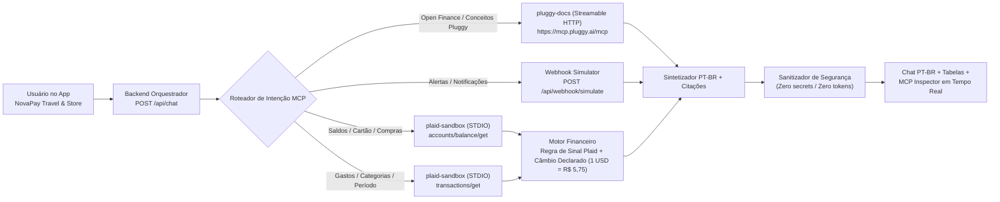

# OpenSpec — NovaPay Travel & Store Embedded Finance Assistant (Lovable / Web App)

Este documento registra a **especificação OpenSpec** completa utilizada para projetar e construir o aplicativo web de **Embedded Finance** integrado ao ecossistema **MCP (Pluggy Docs + Plaid Sandbox)**, bem como o detalhamento técnico do fluxo ponta a ponta e os ajustes realizados na implementação da Etapa 2.

---

## 1. Prompt OpenSpec Enviado ao Builder (Lovable / Full-Stack Web App)

```markdown
# OpenSpec v1.0 — Embedded Finance Chat App ("NovaPay Travel & Store Assistant")

## 1. Contexto & Proposta de Valor ("Onde o cliente já está")
Construa uma aplicação web full-stack de **Embedded Finance** embutida na plataforma **NovaPay Travel & Store** (marketplace de passagens aéreas, hospedagens e eletrônicos).
O cliente está avaliando uma compra relevante (ex.: passagem aérea São Paulo → Lisboa por R$ 2.400,00 ou um notebook de R$ 4.500,00) e precisa consultar sua saúde financeira real (saldos bancários, fatura de cartão, padrões de gasto por categoria e impacto no orçamento) **sem sair do fluxo de compra**.

## 2. Requisito Obrigatório de Transparência & Segurança
- Exibir de forma permanente no cabeçalho E no rodapé o aviso:
  **"Ambiente de Demonstração Sandbox — Dados Fictícios (Plaid Sandbox & Pluggy MCP Docs)"**
- Arquitetura **Etapa 2 (Backend Seguro)**: o frontend NUNCA recebe nem armazena `PLAID_CLIENT_ID`, `PLAID_SECRET` ou `access_token`. Toda orquestração passa pelos endpoints `/api/financial-summary`, `/api/chat` e `/api/webhook/simulate`, com fallback determinístico fiel ao schema Plaid/Pluggy para funcionamento garantido em demonstrações públicas.

## 3. Contrato de Dados & Regras Financeiras
1. **Regra de Sinal da Plaid (`transactions/get`):**
   - `amount > 0` = saída de dinheiro (gasto/débito).
   - `amount < 0` = entrada de dinheiro (salário, estorno, crédito) — NUNCA entra no ranking de gastos.
2. **Cartão de Crédito (`accounts/balance/get` com `type: "credit"`):**
   - `balances.current` = fatura atual / dívida (passivo), NUNCA somado ao caixa líquido.
   - Limite disponível = `balances.limit - balances.current`.
3. **Conversão USD → BRL Declarada:**
   - Taxa explícita: `1 USD = R$ 5,75 — câmbio comercial de referência declarado`.
   - Toggle interativo de moeda (`BRL` / `USD`) sincronizado com os cards e respostas do chat.
4. **Análise por Categoria e Período:**
   - Filtro de janela temporal (30, 60 ou 90 dias).
   - Identificação automática dos **3 principais padrões de gasto** com tabela Markdown (Categoria, Qtd., Total USD, Total BRL, % do total).

## 4. Layout Split-Screen Fintech Sênior (Dark/Slate)
- **Painel Esquerdo (Contexto Embedded Finance & Observabilidade MCP):**
  - Card do carrinho/decisão NovaPay Travel & Store.
  - Toggle de moeda BRL/USD + selo de taxa de câmbio declarada.
  - Cards de Contas & Saldos (Conta Corrente, Poupança e Cartão de Crédito com explicação da dívida e barra de uso de limite).
  - Filtro de período (30d / 60d / 90d) + resumo por categoria.
  - **Inspector MCP em Tempo Real:** exibe qual servidor (`plaid-sandbox` STDIO vs `pluggy-docs` Streamable HTTP vs `webhook`), ferramenta chamada, modo de execução e latência.
  - **Simulador de Webhook → Alerta WhatsApp/Push:** dispara eventos realistas (`transactions/created`, `credit_card/statement_closing`, `budget/threshold_exceeded`) exibindo payload técnico e preview da mensagem no WhatsApp/Push.
- **Painel Direito (Chat Inteligente em Português):**
  - 5 botões de perguntas rápidas cobrindo 100% dos cenários de avaliação:
    1. "Qual é o meu saldo atual e quanto tenho de dívida no cartão?"
    2. "Mostre uma tabela com meus 3 principais padrões de gasto e gastos por categoria."
    3. "Posso comprar uma passagem de R$ 2.400 agora sem comprometer meu orçamento?"
    4. "O que é um Item na Pluggy e qual a diferença para o Open Finance Brasil?"
    5. "Simular alerta de webhook de nova transação no WhatsApp."
  - Renderização limpa de tabelas Markdown, badges das ferramentas MCP acionadas e input livre para qualquer pergunta personalizada (incluindo valores de compra dinâmicos em R$).
```

---

## 2. Explicação Técnica do Fluxo End-to-End



### Etapa A — Pergunta do Usuário & Roteamento MCP
1. O usuário interage no painel de chat embutido na **NovaPay Travel & Store**.
2. O orquestrador analisa a intenção da mensagem e roteia para o servidor MCP adequado:
   - **Conceitos de Open Finance Brasil / Pluggy** (ex.: *"O que é um Item na Pluggy?"*, *"Como funciona consentimento?"*, *"Connectors"*) → aciona **`pluggy-docs`** via **Streamable HTTP** (`https://mcp.pluggy.ai/mcp`, sem necessidade de chave), com base de conhecimento oficial como resiliência.
   - **Dados Financeiros do Cliente** (saldos, cartão, gastos por categoria, decisão de compra) → aciona **`plaid-sandbox`** (`accounts/balance/get` e/ou `transactions/get`). No backend Etapa 2, quando `PLAID_CLIENT_ID` e `PLAID_SECRET` estão presentes no ambiente do servidor, o backend autentica no Plaid Sandbox (`https://sandbox.plaid.com`); quando ausentes (como em demonstrações públicas sem chaves), o **Motor Sandbox Determinístico Fiel ao Schema Plaid** assume de forma transparente e sinalizada no MCP Inspector.
   - **Eventos Assíncronos / Alertas** → aciona o **Simulador de Webhook** gerando o payload de evento e o card de notificação WhatsApp/Push.

### Etapa B — Regra de Sinal da Plaid (Ponto Crítico de Engenharia)
Um erro clássico ao construir agentes financeiros com Plaid é tratar todas as transações como positivas ou somar o saldo de cartão ao caixa disponível. Nossa engine aplica validações determinísticas testadas em suíte automatizada (`tests/financialEngine.test.ts`):
- **Transações (`transactions/get`):**
  - `amount > 0` → **Saída / Gasto** (ex.: `United Airlines +248.50 USD`, `Starbucks +18.40 USD`). Entra no cálculo de gastos por categoria e nos 3 principais padrões de gasto.
  - `amount < 0` → **Entrada / Crédito** (ex.: `TechCorp Payroll -2850.00 USD`, `Cashback/Estorno -42.00 USD`). Contabilizado separadamente como receita/crédito e **nunca** somado aos gastos.
- **Contas de Cartão de Crédito (`type === "credit"`):**
  - `balances.current` (ex.: `US$ 410,00` / `R$ 2.357,50`) representa **dívida / fatura atual**, nunca saldo positivo.
  - O **Patrimônio Líquido Disponível (Posição Líquida)** é calculado como:
    $$\text{Posição Líquida} = (\text{Conta Corrente} + \text{Poupança}) - \text{Fatura do Cartão}$$
  - O **Limite Disponível do Cartão** é:
    $$\text{Limite Disponível} = \text{Limite Total} - \text{Fatura Atual}$$

### Etapa C — Plaid Sandbox vs Open Finance Brasil (Pluggy)
| Dimensão | Plaid Sandbox (Usado na Demo de Dados) | Open Finance Brasil via Pluggy (Produção BR) |
|---|---|---|
| **Regulação** | Ecossistema EUA/Global (dados sintéticos em Sandbox) | Regulado pelo **Banco Central do Brasil (Bacen)** com padrões FAPI/OAuth2 |
| **Consentimento** | Token de teste Sandbox (`access_token`) gerado sem usuário real | Consentimento explícito, granular por escopo, com prazo e revogação pelo cliente |
| **Entidade de Conexão** | `Item` (credencial de teste no Sandbox) | **`Item`** vinculado a um **`Connector`** (banco/instituição BR), com estados `UPDATED`, `UPDATING`, `LOGIN_ERROR`, `WAITING_USER_INPUT` |
| **Moeda & Formatação** | `USD` (exige conversão declarada para `BRL`) | `BRL` nativo com categorias compatíveis com varejo e bancos brasileiros |
| **Atualização Assíncrona** | Polling / Webhooks Sandbox | **Webhooks Pluggy** (`item/updated`, `transactions/created`, `transactions/updated`) para alertas proativos em WhatsApp/Push |

### Etapa D — Ajustes Realizados Pós-OpenSpec (Evolução Sênior)
Durante a implementação e validação da especificação, aplicamos 5 refinamentos de engenharia:
1. **Resiliência Híbrida (Serverless + Static SPA):** Além do backend Express (`server/`) e Vercel Serverless Functions (`api/`), o frontend inclui fallback transparente para o motor determinístico compartilhado (`src/core/`) caso seja acessado em hospedagem estática (como GitHub Pages), garantindo 100% de funcionalidade ao avaliador sem tela quebrada.
2. **Suporte a Redirect 307 no Pluggy MCP:** Verificamos que `https://mcp.pluggy.ai/mcp` responde com `307 Temporary Redirect` para `/en/mcp`; o cliente HTTP (`server/mcpClient.ts`) segue redirecionamentos (`redirect: 'follow'`) e envia cabeçalhos compatíveis com MCP Streamable HTTP (`Accept: application/json, text/event-stream`).
3. **Extração Dinâmica de Valores em Perguntas de Compra:** O assistente não responde apenas ao exemplo fixo de `R$ 2.400`; ele interpreta qualquer valor digitado pelo usuário em reais (ex.: *"Posso comprar um notebook de R$ 4.500?"* ou *"Passagem de R$ 1.800"*) e recalcula liquidez, reserva pós-compra e impacto no limite do cartão em tempo real.
4. **Sanitização Defensiva de Respostas:** Criamos `sanitizeResponsePayload` para mascarar preventivamente qualquer campo sensível (`PLAID_SECRET`, `PLAID_CLIENT_ID`, `access_token`, `secret`, `token`) antes de devolver JSON ao cliente.
5. **Skill Reutilizável de Agente:** Toda a governança MCP foi encapsulada em `.agent/skills/mcp-financial-connector/SKILL.md` para reutilização imediata em novos projetos.
